<a href="https://ahmadverse.vercel.app/"></a>

  
  
  
  
  



  

  <a href="https://github.com/ahmadtahir1399/Todovex"></a>
  <a href="https://github.com/ahmadtahir1399/storeit-cloud-storage"></a>

  <a href="https://mega-blog-zeta.vercel.app"></a>
  <a href="https://github.com/ahmadtahir1399/react-todo-app"></a>

  <a href="https://github.com/ahmadtahir1399/vanilla-js-ecommerce-store"></a>
  <a href="https://github.com/ahmadtahir1399/react-course-projects"></a>


  

  <picture>
    <source media="(prefers-color-scheme: dark)" srcset="https://raw.githubusercontent.com/ahmadtahir1399/ahmadtahir1399/output/github-snake-dark.svg" />
    <source media="(prefers-color-scheme: light)" srcset="https://raw.githubusercontent.com/ahmadtahir1399/ahmadtahir1399/output/github-snake.svg" />
    
  </picture>

<a href="https://ahmadverse.vercel.app/contact"></a>
